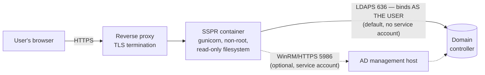

# Self-service Active Directory password reset

A small, auditable web application that lets domain users change their own
Active Directory password, using their current password as proof of identity.
Built to be forked and run inside a company.

[](SECURITY.md)
[](pyproject.toml)
[](LICENSE)

> **Forked version 1 (pre-2.0.0)?** It had a remote command execution flaw and
> committed credentials. Read [SECURITY.md](SECURITY.md) before anything else.

---

## Why run this

Password resets are commonly 20–40% of service desk volume, and each one costs
the user their morning and an administrator their focus. This removes that
queue for the common case — the user knows their password and simply wants to
change it.

- **The user's own password is the authentication factor.** AD verifies it. The
  application never decides who someone is, so there is no identity-proofing
  system to get wrong, and no password-recovery flow to abuse.
- **It is a *change*, not an administrative *reset*.** DPAPI data, EFS keys and
  stored credentials survive, which an admin reset would orphan.
- **No schema changes, no agent on a domain controller, no MSI.** A container
  next to your existing infrastructure.
- **No privileged service account at all**, on the default backend. If the web
  tier is compromised, the attacker does not inherit reset rights across your
  directory.
- **Small enough to actually review.** Roughly 1,000 lines of Python. Your
  security team can read all of it before trusting it, which is not true of the
  commercial alternatives.
- **Free and self-hosted.** No per-user licence.

### What it deliberately does not do

Users who have **forgotten** their password still call the helpdesk. Supporting
them means building identity proofing — security questions, email or SMS
one-time codes — and a weak implementation of that is worse than the phone
call. See [the threat model](docs/threat-model.md#deliberately-out-of-scope).

## Architecture



Two interchangeable back ends:

| | `AD_BACKEND=ldap` (default) | `AD_BACKEND=winrm` |
|---|---|---|
| Privileged service account | **none** | required |
| Expired / must-change passwords | not supported | supported |
| Hosts to harden | 1 | 2 |
| If the web tier is compromised | one session's traffic | reset rights on the delegated OU |

Pick `ldap` unless you must serve users whose password has already expired —
Active Directory refuses an LDAP bind for those accounts, which is the one
thing the Windows hop buys you. [Full detail](docs/architecture.md).

## Quick start

```bash
git clone https://github.com/<your-org>/ADDS-UsersPasswordReset.git
cd ADDS-UsersPasswordReset

cp .env.example .env
python -c "import secrets; print('SECRET_KEY=' + secrets.token_urlsafe(48))" >> .env
$EDITOR .env                     # set LDAP_SERVER, LDAP_BASE_DN, LDAP_UPN_SUFFIX

mkdir -p certs && cp /path/to/ad-ca.pem certs/   # your AD issuing CA

docker compose up -d --build
curl -s localhost:8000/readyz    # {"status":"ok","backend":"ldap"}
```

Then put TLS in front of it — the app does not terminate TLS itself and binds
to loopback by default. See [docs/deployment.md](docs/deployment.md) for nginx
and Kubernetes examples.

### Local development

```bash
python -m venv .venv && source .venv/bin/activate
pip install -r requirements-dev.txt
pytest -q
ruff check .
```

## Configuration

Every setting is an environment variable; no secret has a default, and the app
refuses to start on an incomplete or unsafe configuration. Full annotated list
in [.env.example](.env.example).

| Variable | Default | Notes |
|---|---|---|
| `SECRET_KEY` | — | Required, ≥32 chars. Startup fails without it. |
| `AD_BACKEND` | `ldap` | `ldap` or `winrm` |
| `BEHIND_PROXY` / `PROXY_HOPS` | `false` / `1` | Set when a proxy terminates TLS, or rate limiting sees only the proxy |
| `RATE_LIMIT_PER_IP` | `10 per hour` | Failed attempts only |
| `RATE_LIMIT_PER_USER` | `5 per hour` | Keep below your domain lockout threshold |
| `RATE_LIMIT_STORAGE_URI` | `memory://` | **Use Redis** for >1 worker, or limits multiply |
| `PASSWORD_MIN_LENGTH` | `12` | Pre-flight only; AD remains authoritative |
| `PASSWORD_MIN_CLASSES` | `3` | Matches AD's own 3-of-4 complexity rule |
| `LDAP_SERVER` | — | Hostname, not IP — the certificate is validated against it |
| `WINRM_ENDPOINT` | — | HTTPS only; port 5985 is rejected |

## Security posture

This is an authentication endpoint that accepts credentials from anonymous
callers. It is built accordingly:

- User input is never concatenated into a command, a shell string or an LDAP
  filter. The `winrm` backend base64-encapsulates every parameter; six
  injection payloads are pinned in the test suite.
- Success is reported **only** when the domain controller confirms the change.
- CSRF tokens on every POST; strict CSP with no third-party origins; HSTS,
  `frame-ancestors 'none'`, `no-store` on every response.
- Per-IP and per-username rate limiting, charged only on failure.
- Structured JSON audit log with no password material — enforced by a test.
- Non-root container, read-only filesystem, all capabilities dropped.
- Certificate validation on by default for both back ends.

Read the [threat model](docs/threat-model.md) for the residual risks, which
include timing-based username enumeration and distributed password spraying.
Neither is fully mitigated, and you should know that before you deploy.

**Have your security team review your fork.** Do not deploy an unreviewed
self-service password tool because a README said it was hardened.

## Documentation

| | |
|---|---|
| [docs/architecture.md](docs/architecture.md) | Diagrams, backend trade-off, module map |
| [docs/deployment.md](docs/deployment.md) | Fork, configure, proxy, scale, upgrade from v1 |
| [docs/ad-delegation.md](docs/ad-delegation.md) | Least-privilege AD setup, LDAPS and WinRM |
| [docs/threat-model.md](docs/threat-model.md) | Threats, controls, residual risk |
| [SECURITY.md](SECURITY.md) | Reporting, v1 advisory, hardening checklist |
| [CHANGELOG.md](CHANGELOG.md) | What changed in 2.0.0 and why |

## Project layout

```
.
├── wsgi.py                     # gunicorn entry point
├── app/
│   ├── __init__.py             # application factory
│   ├── config.py               # environment -> typed config, fail-fast
│   ├── routes.py               # HTTP layer
│   ├── policy.py               # password pre-flight rules
│   ├── errors.py               # failure taxonomy + safe user messages
│   ├── audit.py                # structured audit log
│   ├── security.py             # response hardening headers
│   ├── extensions.py           # CSRF + rate limiter
│   ├── backends/
│   │   ├── ldap_backend.py     # LDAPS, binds as the user
│   │   └── winrm_backend.py    # PowerShell, parameterised
│   ├── templates/
│   └── static/
├── tests/                      # includes regressions for every v1 defect
├── docs/
└── scripts/
    └── purge-secrets-from-history.sh
```

## Contributing

Pull requests welcome. Please keep `pytest` and `ruff check .` green, and add a
regression test for any security-relevant fix. Report vulnerabilities through a
private advisory rather than a public issue — see [SECURITY.md](SECURITY.md).

## License

Apache License 2.0 — see [LICENSE](LICENSE).

Permissive, with an explicit patent grant: you may fork, modify and deploy
this internally or commercially, provided you keep the copyright and licence
notices and state any significant changes you make.
