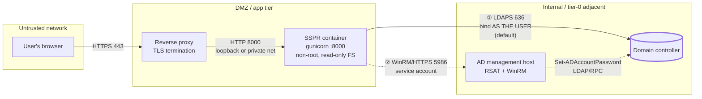
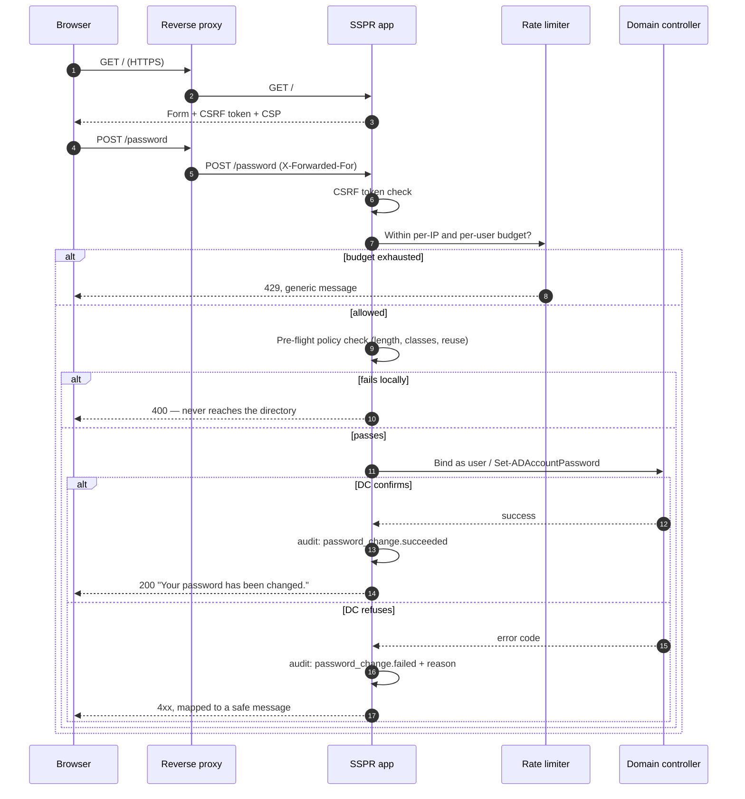
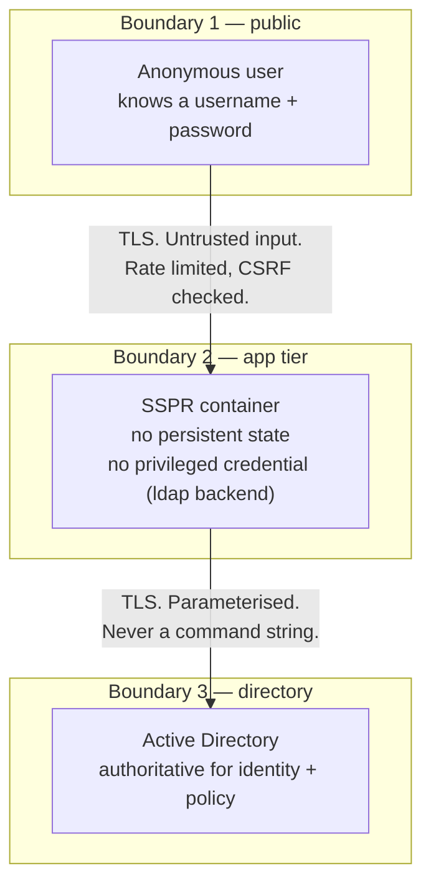

# Architecture

GitHub renders the Mermaid blocks below as diagrams.

## The decision that shapes everything

The application changes a password *on the user's behalf, using the user's own
current password as proof of identity*. It is a **change**, not an administrative
**reset**. Active Directory itself verifies the old password, which means:

- The service never has to prove who the user is — AD does it.
- The user keeps their DPAPI-protected data, EFS keys and stored credentials,
  which an administrative reset would orphan.
- There is no password-recovery flow to abuse: someone who has forgotten their
  password entirely still has to call the helpdesk. That is a deliberate scope
  limit, not an omission.

## Two back ends, one trade-off

`AD_BACKEND` selects how the change reaches the directory.

### ① `AD_BACKEND=ldap` — recommended

The container binds to a domain controller over LDAPS **as the user**, then
issues the `unicodePwd` delete/add pair that constitutes a password change.

- **The application holds no privileged credential at all.** If the container is
  compromised, the attacker gains nothing they could not get by phishing one
  user. This is the single biggest improvement over the original design.
- No PowerShell, no shell, no command string — the injection class is removed
  rather than escaped around.
- One hop instead of two: no Windows jump box to patch, monitor and licence.

**Limitation, and it is a real one:** Active Directory refuses a simple bind for
an account whose password has already expired or is flagged *must change at next
logon* (bind sub-codes `532` and `773`). Those users cannot self-serve through
this backend — which is exactly the population most likely to need it. The app
detects both and tells the user to go to a domain-joined workstation or the
helpdesk.

### ② `AD_BACKEND=winrm` — the original topology, hardened

Preserves the shape the first version used: a Linux web tier driving a Windows
host that carries the AD management tools. It runs `Set-ADAccountPassword` with
`-OldPassword`, so AD still verifies the user.

- **Handles expired and must-change accounts**, because the operation is
  performed by a delegated service account rather than an interactive bind.
- Costs you a service account with `Reset password` / `Change password`
  delegated on the target OU — a credential worth protecting. See
  [ad-delegation.md](ad-delegation.md).
- Two hosts to harden instead of one.

### Choosing

| | `ldap` | `winrm` |
|---|---|---|
| Privileged service account | none | required |
| Expired / must-change passwords | **not supported** | supported |
| Hosts to harden | 1 | 2 |
| Blast radius if the web tier is popped | one user's session | delegated reset rights |
| Protocol | LDAPS 636 | WinRM/HTTPS 5986 |

Start with `ldap`. Move to `winrm` only if serving expired passwords matters
more to you than eliminating the privileged credential — and if you do, read the
[threat model](threat-model.md) first.

## Request flow

The branch that matters: **success is reported only on the path where the domain
controller confirmed the change.** Version 1 flashed "Password changed
successfully" unconditionally, including when the reset had failed.

## Trust boundaries

| Boundary | Crossing | Control |
|---|---|---|
| Public → app | Username, old and new password | TLS, CSRF token, per-IP and per-user rate limits, `MAX_CONTENT_LENGTH`, strict CSP |
| App → directory | Same values, as typed data | LDAPS or WinRM/HTTPS with certificate validation; base64-encapsulated PowerShell parameters; no shell |
| App → operator | Audit events | Structured JSON on stdout; **never** password material |
| Directory → app | Error codes | Mapped to generic user messages; infrastructure detail stays in the log |

## Why the application is stateless

No database, no session store, no password cache. The only mutable state is the
rate-limiter's counters, which are deliberately external (`RATE_LIMIT_STORAGE_URI`).
That means:

- Horizontal scaling is trivial; any replica can serve any request.
- There is nothing at rest worth stealing from the app tier.
- **But:** with the default `memory://`, counters are per worker and per
  replica, so the effective limit is `workers × replicas × configured value`.
  Point it at Redis for any real deployment.

## Module map

| Path | Responsibility |
|---|---|
| `wsgi.py` | Entry point for gunicorn. Loads `.env`, builds the app. |
| `app/__init__.py` | Application factory, proxy handling, error handlers. |
| `app/config.py` | Environment → typed config. Fails fast; no secret has a default. |
| `app/routes.py` | HTTP layer. Validate, delegate, report honestly. |
| `app/policy.py` | Pre-flight password rules. AD remains authoritative. |
| `app/backends/` | `ADBackend` interface plus the LDAPS and WinRM implementations. |
| `app/errors.py` | Failure taxonomy; carries the safe user-facing message. |
| `app/audit.py` | Structured audit log. Accepts no password material. |
| `app/security.py` | Response hardening headers and CSP. |
| `app/extensions.py` | CSRF and rate-limiter instances, and their key functions. |
